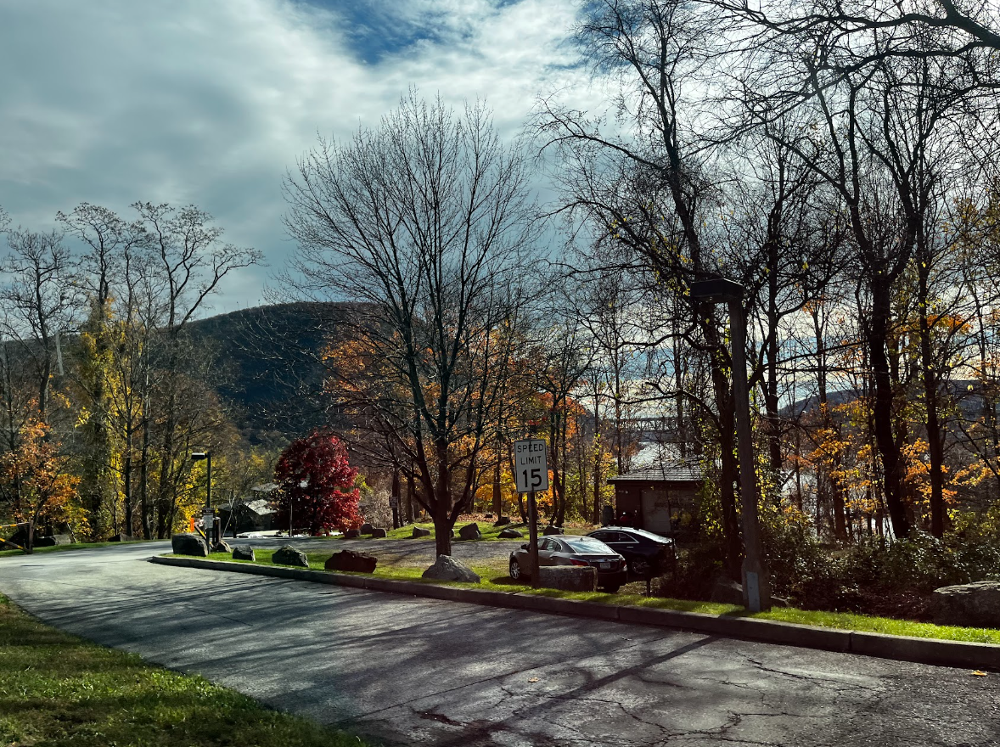
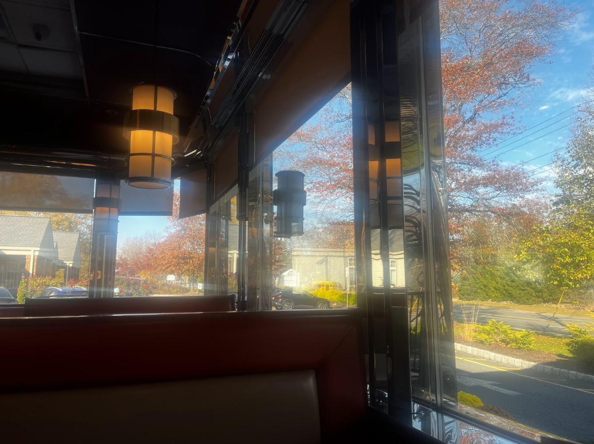
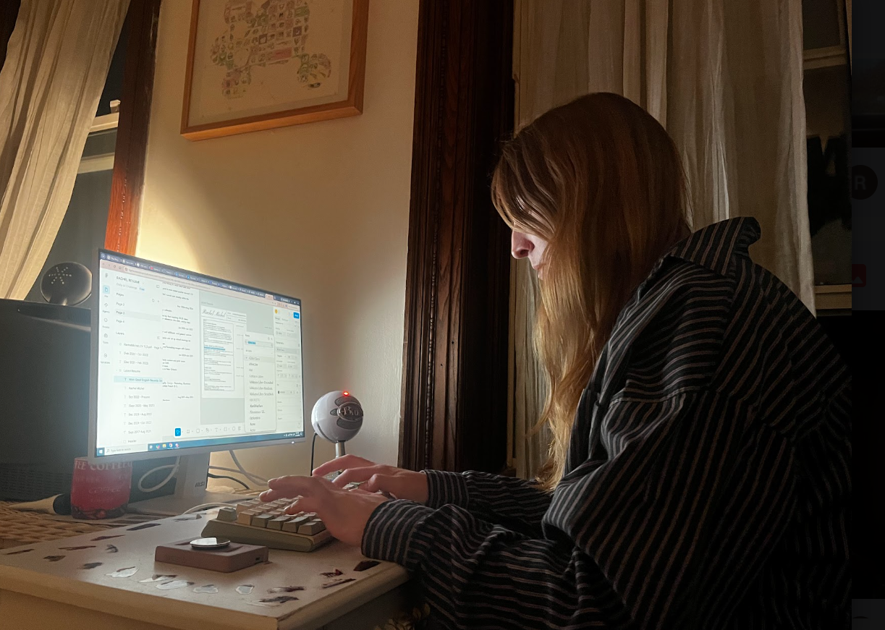
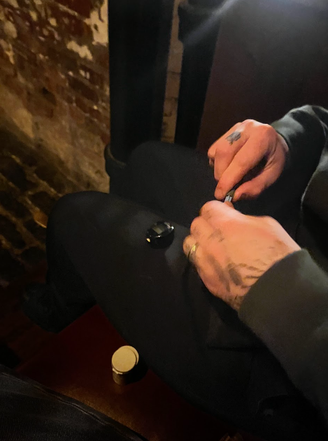
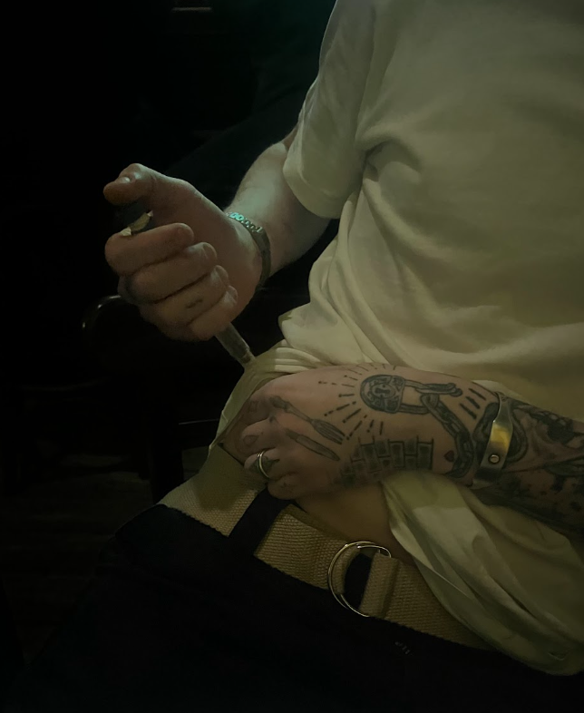
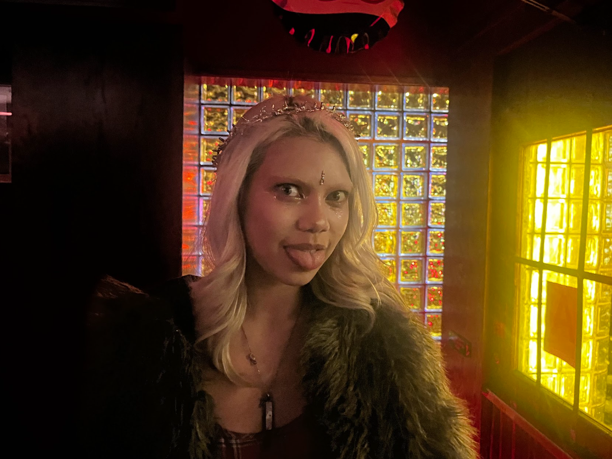
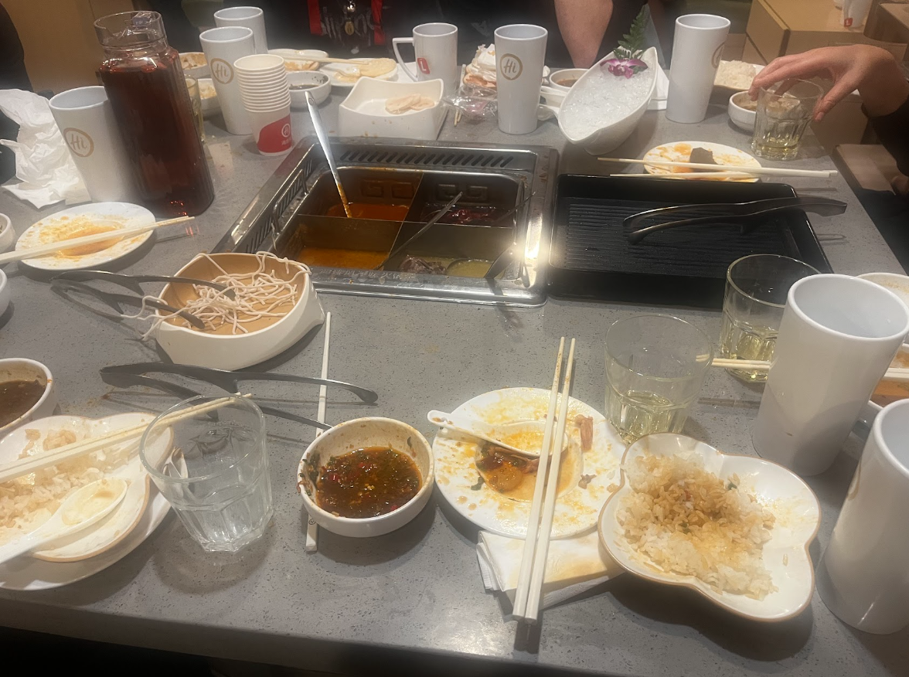
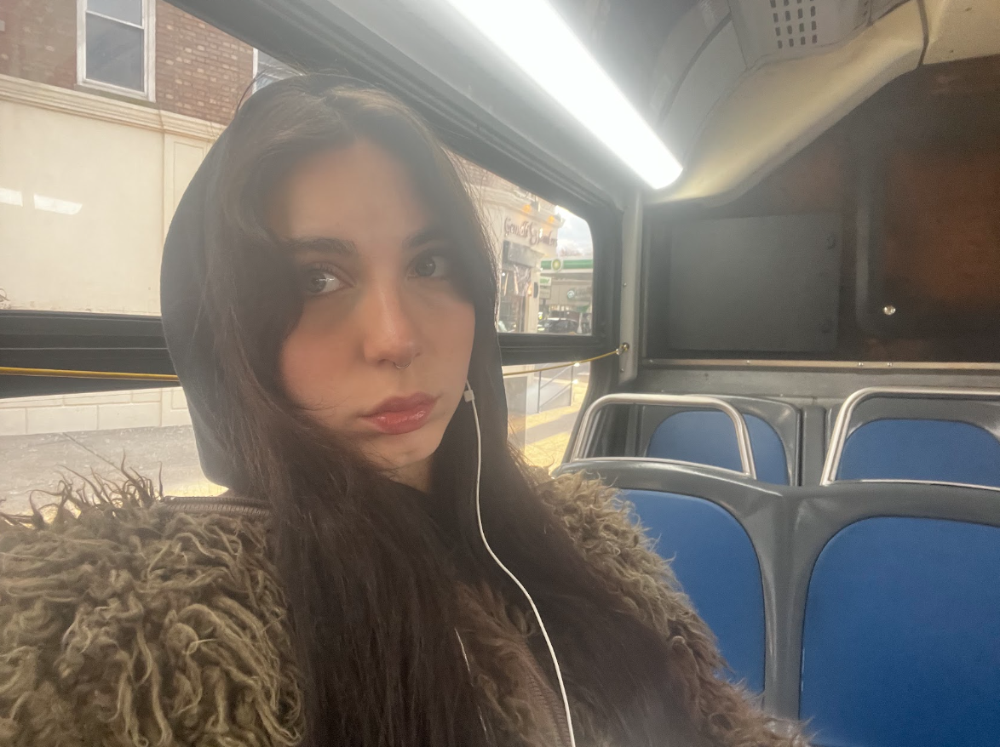
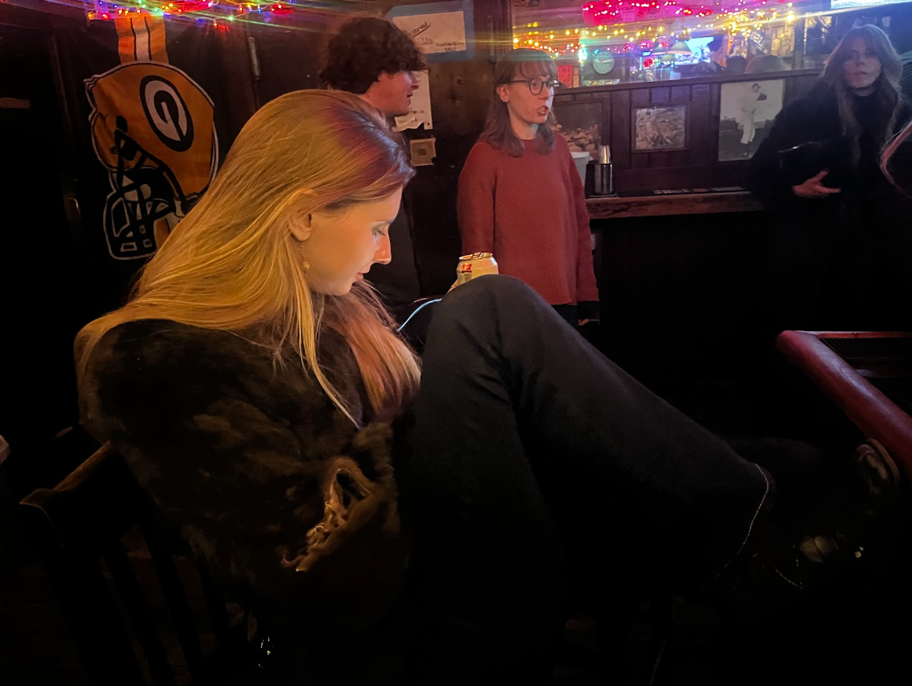

I woke up at 7:30 am last Tuesday completely well-rested and ready for the day, so I decided to participate in Take Your Roomie To Work Day and accompany Nick on his drive Storm King for a job he was on. I work evenings so I seldom ever participate in the Morning Commute. The experience was illuminating to the status of the human condition. We walked 15 minutes to the L and the cold morning air made my jaw ache. As we walked, I saw my neighborhood crush that I always see on the same block at the bus stop on said block and it made me think about what we can infer about stranger's lives from the trails they carve out for us to follow. I learned that a seat is a hot commodity on the 8:30 Manhattan-bound L train, and that transferring to the G at Lorimer makes me feel like sheeple. 

I love Hudson Valley. It's such a beautiful part of the state, especially this time of year.

I was too enraptured by all the sights before me to remember to take pictures. The only photo I took is regrettably of a parking lot. You get the idea though.

Nick loves diners so we found one nearby to have lunch at before we drove back to the city. I feel like I can be anybody, in the best way, when I'm drinking a cup of shitty diner coffee while flipping through pages of vinyl-laminated images of milkshakes and abominations of sandwiches. 

I got back home around 3 and really wanted to nap but I needed to get some work done and prepare for my night ahead because I was meeting up with Chloe around 6. Chloe is a genius designer and kindly agreed to help me make my resume look like I too am a design genius with illustrious experience in a variety of creative fields. 2027 is the year of my gainful employment, calling it now. Place your polymarket bets now. 

I left Chloe's with a shiny, newly-vamped resume around 7:30 and returned home to get ready for The Rest of My Night, which I cannot detail here yet, but maybe I will be open to talking about in the future. It could probably use its own entry. 

Wednesday would have been uneventful, but I ended up going out for after work drinks at Sip and Guzzle with the cute new chef at my job. Sip and Guzzle is one of the more famous and highly-rated cocktail bars in the country right now, but I think all that is negated by the fact that it has a really dumb name that feels borderline embarrassing to say. I don't know how that got cleared. Nevertheless, I really enjoyed the company and drinks we shared, including a strawberry Sichuan pepper mezcal drink and a chicken fat infused martini that kind of tasted like ramen noodles but whatever. 

This is coworker Devan giving me a blood sugar finger prick test. Not to flex, but he said my blood sugar level was near perfect. 

We had such a fun time that we may or may not have run it back the next night at Toad Hall. I've been going there semi-often lately because the only bar I can ever think of nearish to my work that isn't insane. Don't worry about it. Where do people go out in Greenwich Village/Soho that isn't completely fried I'm so serious I want to know.

This entry has taken me far, far too long because my shitty website admin page doesn't work very well. Let's see if this works. I'll end the entry with a few photos from the rest of the weekend, which was now last weekend, because this took so long. 

